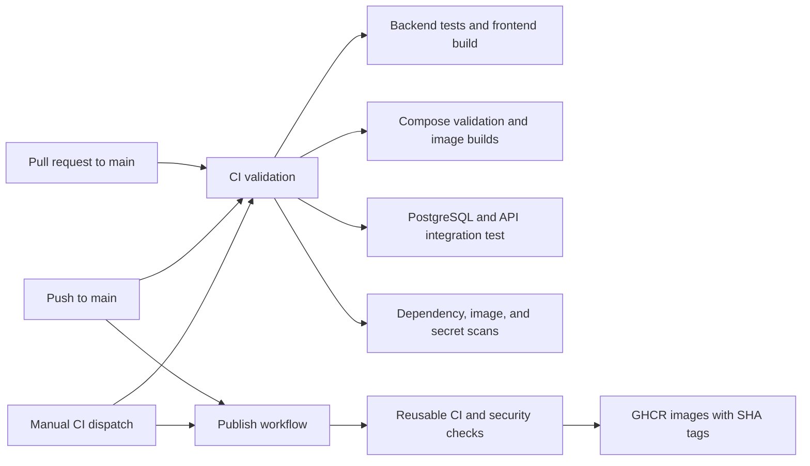

# IdeaBoard Platform

IdeaBoard is a focused idea-sharing application: users can submit ideas and retrieve the persisted board. The application foundation and a Docker Compose deployment are implemented with a React frontend, FastAPI backend, and PostgreSQL.

## Architecture

- **Frontend:** React 18, Vite, JavaScript, and Tailwind CSS. The UI calls the REST API through a small, separate API client.
- **Backend:** Python 3.12+, FastAPI, Pydantic, SQLAlchemy 2, and psycopg 3.
- **Database:** PostgreSQL. SQLAlchemy creates the `ideas` table through an explicit initialization command; the API does not perform schema changes on startup.
- **Runtime:** Environment-based configuration, configurable browser origins, health checks, and no cloud-specific application dependencies.
- **Container deployment:** Multi-stage frontend/backend image builds, an unprivileged Nginx reverse proxy, a one-shot database initializer, private service networks, and a persistent PostgreSQL volume.

## Repository structure

```text
backend/
  app/
    api/routes/       # Idea and health endpoints
    config.py         # Environment-backed settings
    database.py       # SQLAlchemy engine and session dependency
    init_db.py        # Explicit schema initialization
    models.py         # SQLAlchemy models
    schemas.py        # Pydantic request/response schemas
    main.py           # FastAPI application
  tests/              # Pytest API tests (SQLite test database)
  requirements.txt
frontend/
  Dockerfile          # Vite build and unprivileged Nginx runtime
  nginx.conf          # Static hosting and API reverse proxy
  src/
    api/              # HTTP client
    App.jsx           # Idea board UI
    styles.css
  package.json
  package-lock.json
  vite.config.js
compose.yaml
.env.example
```

## Prerequisites

- Python 3.12 or newer
- Node.js 20 or newer and npm
- PostgreSQL 14 or newer for host-based development (Compose provides PostgreSQL)
- Docker Desktop or Docker Engine with the Compose v2 plugin (for containerized operation)

## Environment configuration

Copy `.env.example` to `.env` in the repository root and set the PostgreSQL values. `.env` is ignored by Git.

| Variable | Required | Default | Description |
| --- | --- | --- | --- |
| `POSTGRES_HOST` | No | `localhost` | PostgreSQL server host |
| `POSTGRES_PORT` | No | `5432` | PostgreSQL server port |
| `POSTGRES_DB` | No | `ideaboard` | Database name |
| `POSTGRES_USER` | No | `ideaboard` | Database user |
| `POSTGRES_PASSWORD` | Yes | — | Database password |
| `CORS_ORIGINS` | No | `http://localhost:5173` | Comma-separated allowed browser origins |
| `VITE_API_BASE_URL` | No | Empty | Frontend API origin; empty uses the Vite proxy in development |
| `APP_PORT` | No | `8080` | Host loopback port for the Compose frontend |

Create the PostgreSQL database and user before initializing the schema. For example, from a PostgreSQL administrator session:

```sql
CREATE USER ideaboard WITH PASSWORD 'replace-with-a-local-password';
CREATE DATABASE ideaboard OWNER ideaboard;
```

## Local development

From the repository root, create and activate a virtual environment, then install backend dependencies:

```powershell
py -3.12 -m venv backend\.venv
backend\.venv\Scripts\Activate.ps1
python -m pip install -r backend\requirements.txt
```

Initialize the database and start the API:

```powershell
$env:PYTHONPATH = "backend"
python -m app.init_db
python -m uvicorn app.main:app --app-dir backend --reload
```

In another terminal, install frontend dependencies and start Vite:

```powershell
Set-Location frontend
npm install
npm run dev
```

Open <http://localhost:5173>. The Vite development server proxies `/api` and `/health` requests to `http://localhost:8000`. Configure `VITE_API_BASE_URL` at frontend build time to use another API origin.

## Docker Compose

Docker Compose runs PostgreSQL, the API, a one-shot schema initializer, and the Nginx-served frontend. Only the frontend is published to the host, bound to loopback; the API and database have no host port mappings. The frontend reverse-proxies `/api/`, `/health`, `/docs`, and `/openapi.json` to the backend over a private application network. PostgreSQL is reachable only from the backend over a separate private network.

1. Copy `.env.example` to `.env` in the repository root and replace `POSTGRES_PASSWORD` with a strong local password. Do not commit `.env`.
2. From the repository root, build and start the services:

   ```powershell
   docker compose up --build -d
   docker compose ps
   ```

   Compose waits for PostgreSQL to become healthy, runs the existing `python -m app.init_db` process once, and waits for the backend health check before starting the frontend.
3. Open <http://localhost:8080>. The port is bound to `127.0.0.1`; set `APP_PORT` in `.env` to choose another local port.

Compose overrides `POSTGRES_HOST` and `POSTGRES_PORT` for the application containers to use the private `db:5432` address. If a password contains a dollar sign, quote its value with single quotes in `.env` so Compose treats it literally.

Use the same REST API through the reverse proxy:

```powershell
Invoke-RestMethod -Method Post `
  -Uri http://localhost:8080/api/ideas `
  -ContentType 'application/json' `
  -Body '{"content":"Make it easier to share ideas"}'

Invoke-RestMethod -Method Get -Uri http://localhost:8080/api/ideas
Invoke-RestMethod -Method Get -Uri http://localhost:8080/health
```

Inspect service logs with `docker compose logs -f`. Stop the services with `docker compose down`; the named `postgres-data` volume is retained across container recreation. **This volume contains persisted ideas.** Remove it only when intentionally deleting local data with `docker compose down --volumes`.

The backend and frontend images run as non-root users. The backend has a read-only root filesystem and dropped Linux capabilities; the frontend uses the unprivileged Nginx image. Container health checks gate service startup. To apply a changed application schema in this phase, update the existing SQLAlchemy models and initializer; this setup does not add a separate migration framework.

## API

Interactive OpenAPI documentation is available at <http://localhost:8080/docs> with Compose, or <http://localhost:8000/docs> when running the backend directly.

| Method | Endpoint | Behavior |
| --- | --- | --- |
| `GET` | `/api/ideas` | Returns ideas, newest first |
| `POST` | `/api/ideas` | Creates an idea; returns `201 Created` |
| `GET` | `/health` | Checks database connectivity; returns `503` if unavailable |

Idea content is trimmed, must not be blank, and is limited to 1000 characters. Example:

```powershell
Invoke-RestMethod -Method Post `
  -Uri http://localhost:8000/api/ideas `
  -ContentType 'application/json' `
  -Body '{"content":"Make it easier to share ideas"}'

Invoke-RestMethod -Method Get -Uri http://localhost:8000/api/ideas
```

## Testing and build

Run backend tests from the repository root:

```powershell
$env:PYTHONPATH = "backend"
python -m pytest backend\tests
```

Build the frontend:

```powershell
Set-Location frontend
npm run build
```

Backend tests use an isolated in-memory SQLite database and do not require a running PostgreSQL server. The PostgreSQL health check and live API/database behavior require a configured PostgreSQL instance.

## CI/CD with GitHub Actions

The workflows validate changes and publish container images; they do not deploy to a cloud environment.



### Workflows and validation

- **`.github/workflows/ci.yaml`** runs for pull requests targeting `main`, pushes to `main`, and manual dispatch. It is also reusable by the publishing workflow. Backend validation installs `backend/requirements.txt`, runs pytest, and uploads JUnit XML. Frontend validation uses `npm ci` and `npm run build`; there are currently no lint or type-check scripts in `frontend/package.json`.
- CI validates `compose.yaml` using temporary non-production values, builds both images without pushing, then runs the existing Compose stack in an isolated job. The integration checks wait for service health, request the frontend and proxied `/health`, create and retrieve an idea, and assert blank content returns HTTP 422. Failure logs are collected and the CI-only containers and volume are always removed.
- Security jobs run `pip-audit` against backend requirements, `npm audit` against the committed lockfile, GitHub dependency review for new pull-request vulnerabilities, Gitleaks over repository history, and Trivy against both built runtime images. Trivy scans `UNKNOWN`, `LOW`, `MEDIUM`, `HIGH`, and `CRITICAL` findings and uploads SARIF when repository support and permissions allow. JSON/SARIF and pytest reports are retained as workflow artifacts.
- **`.github/workflows/docker-publish.yaml`** runs on pushes to `main` or manual dispatch. It reuses the full CI workflow and publishes only after that workflow succeeds; manual runs from non-default branches do not publish. Pull requests never publish images.

### npm advisory and security gates

The current npm lockfile contains **GHSA-fc5q-39xc-vjpf**, a HIGH-severity ReDoS advisory affecting transitive `picomatch@4.0.7` in the Vite tooling dependency tree (also reflected by affected `fdir`, `tinyglobby`, and Vite entries in `npm audit`). The scan report is uploaded and its advisory is listed in the job summary. The repository does not downgrade Vite or rewrite the lockfile to clear the finding.

`.github/security/known-npm-advisories.json` records a temporary, exact-version exception through **2026-12-18**. It applies only to the named advisory and the currently locked affected package versions. The audit helper fails on every CRITICAL finding, every other HIGH finding, a changed lock version, or an expired exception. The pull-request dependency review separately blocks newly introduced HIGH/CRITICAL advisories. The exception is not an ignore rule: the full npm report remains available, and re-review or a patched compatible release is required before expiry. The exception does not apply to Trivy or Python findings; those scans fail on reported findings.

The latest local `pip-audit` run also reported **9 known advisories across `python-dotenv==1.0.1`, `pytest==8.3.5`, and `starlette==0.46.2`** (IDs: `PYSEC-2026-2270`, `PYSEC-2026-1845`, `PYSEC-2026-161`, `PYSEC-2026-249`, `PYSEC-2026-248`, `PYSEC-2026-1942`, `PYSEC-2026-1941`, `PYSEC-2026-2281`, and `PYSEC-2026-2280`). The report lists upstream fix versions, but this phase does not change application dependencies; in particular, the Starlette fixes require checking compatibility with the pinned FastAPI version. The Python audit job intentionally fails while findings remain, and the complete JSON report is uploaded. `pip-audit` reports advisories without a severity classification here; unlike GitHub Dependency Review, it does not distinguish newly introduced findings from existing ones.

Local Trivy **0.64.1** scans of the built images on 2026-11-18 also found unresolved container vulnerabilities: the backend OS package scan reported 356 entries (99 HIGH, 2 CRITICAL), its Python package scan reported 15 (3 HIGH), and the frontend OS package scan reported 288 (78 HIGH, 4 CRITICAL). Examples included `CVE-2025-7458` in backend SQLite, `CVE-2023-45853` in backend zlib, and `CVE-2026-42945` in frontend Nginx. These local results are not a GitHub Actions run. The workflow scans all listed severities without ignoring unfixed findings, emits SARIF, and fails the gate on findings; therefore image publication is expected to remain blocked until the vulnerable dependencies/base images are reviewed and updated.

### GHCR images

The publish workflow derives a lowercase GHCR namespace from the repository metadata and builds frontend and backend images separately:

- `ghcr.io/<owner>/<repository>/frontend`
- `ghcr.io/<owner>/<repository>/backend`

Each image receives an immutable `sha-<full-commit-sha>` tag; `latest` is added only for the default-branch publication. OCI metadata labels, Buildx GitHub Actions cache, an SBOM, and maximum-mode provenance are generated. Authentication uses the job-scoped `GITHUB_TOKEN`; no personal access token or production secret is required.

### Repository configuration and run inspection

The workflows target the observed default branch, `main`. Publishing requires Actions to be enabled and the repository's workflow token to have **read repository contents** and **write packages** (the workflow grants `packages: write` only to the publish job). SARIF upload additionally needs `security-events: write` and GitHub code-scanning/Security support; SARIF upload is best-effort, while the Trivy scan itself remains a required gate. Gitleaks uses only the automatically provided read-scoped workflow token.

Review individual jobs and downloadable reports under the repository's **Actions** tab. A successful local validation is not evidence that a GitHub Actions run or GHCR publication has succeeded; those require a run on GitHub with the repository's permissions.

### Reproduce checks locally

From the repository root:

```powershell
$env:PYTHONPATH = "backend"
python -m pytest backend\tests
python -m pip install pip-audit==2.9.0
pip-audit --requirement backend\requirements.txt

Set-Location frontend
npm ci
npm run build
npm audit
Set-Location ..

$envFile = Join-Path $env:TEMP "ideaboard-compose-ci.env"
@"
POSTGRES_DB=ideaboard
POSTGRES_USER=ideaboard
POSTGRES_PASSWORD=$(python -c "import secrets; print(secrets.token_hex(32))")
APP_PORT=18080
CORS_ORIGINS=http://localhost:18080
VITE_API_BASE_URL=
"@ | Set-Content -LiteralPath $envFile -Encoding ascii
docker compose --env-file $envFile -p ideaboard-ci-local config --quiet
docker compose --env-file $envFile -p ideaboard-ci-local up --build --detach --wait
```

To reproduce the Compose integration checks, run the frontend, `/health`, POST, GET, and blank-content requests against `http://localhost:18080` as in the workflow. Then remove only this uniquely named local test stack and its test data:

```powershell
docker compose --env-file $envFile -p ideaboard-ci-local down --volumes --remove-orphans
Remove-Item -LiteralPath $envFile
```

Do not use the test project name for any stack containing data you want to keep. The committed `.env.example` value is a placeholder, not a credential. `npm audit` currently exits non-zero because of the documented GHSA; the workflow applies only its narrow, expiring exception. Python audit findings and Trivy findings are not suppressed.

## Implementation status

Implemented: idea creation and listing, input validation, PostgreSQL persistence, database connectivity health check, configurable CORS/API URL, structured backend logs, API documentation, frontend loading/empty/error/success states, backend API tests, multi-stage Dockerfiles, unprivileged Nginx reverse proxy, Compose health checks, and persistent database storage.

Not implemented: Kubernetes, Helm, Terraform, cloud deployment, AI deployment risk analysis, monitoring integrations, authentication, and automated database migrations.

## Future engineering phases

Kubernetes, Helm, Terraform, and cloud deployment remain separate future phases.
