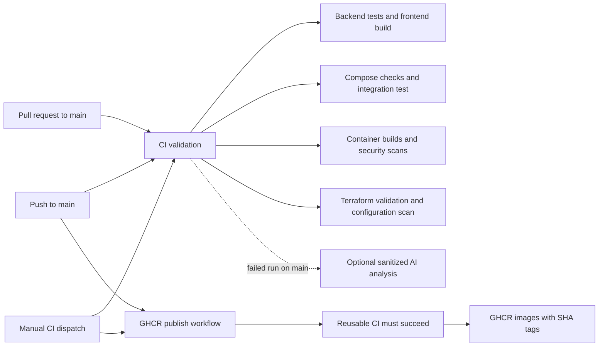

# IdeaBoard Platform

IdeaBoard is a small idea-sharing application and an AWS infrastructure engineering exercise. The application runs locally with Docker Compose; Terraform defines reusable AWS networking, EKS, and RDS resources, but no cloud resources have been deployed.

## Architecture

```mermaid
flowchart LR
  Browser -->|localhost:8080| Nginx
  Nginx -->|/api and /health| FastAPI
  FastAPI --> PostgreSQL
  PostgreSQL --> PostgreSQLVolume[(Persistent Compose volume)]

  subgraph AWS["AWS target architecture (Terraform only; not deployed)"]
    Internet --> IGW[Internet Gateway]
    IGW --> Public[Public subnets: load balancers and NAT]
    Public --> NAT[NAT Gateway(s)]
    NAT --> Private[Private subnets and private AWS endpoints]
    Private --> EKS[EKS control plane and managed worker nodes]
    Private --> RDS[(Encrypted private PostgreSQL RDS)]
    EKS -->|TCP 5432 from worker security group only| RDS
  end

  CI[GitHub Actions] --> Tests[Tests, builds, security scans, Terraform validation]
  CI -->|successful publish gate| GHCR[GitHub Container Registry]
  CI -. failed run .-> AI[Optional sanitized GitHub Models analysis]
```

### Application

- **Frontend:** React 18, Vite, JavaScript, and Tailwind CSS.
- **Backend:** Python 3.12+, FastAPI, Pydantic, SQLAlchemy 2, and psycopg 3.
- **Database:** PostgreSQL; schema initialization is a separate command/container.
- **Application wiring:** The frontend uses a separate API client; backend settings and browser origins are environment-configurable, with no cloud-specific application dependencies.
- **Local runtime:** Docker Compose, private service networks, Nginx reverse proxy, health checks, and a persistent PostgreSQL volume.

### AWS infrastructure scope

Development and production roots reuse the same Terraform modules:

```text
infrastructure/
  modules/
    networking/       # VPC, subnets, IGW, NAT, routes and private AWS endpoints
    kubernetes/       # EKS, KMS secrets encryption, nodes, IAM and CNI Pod Identity
    database/         # Private RDS PostgreSQL, subnet group and restricted SG
  environments/
    development/      # Cost-conscious settings and example variables
    production/       # Multi-AZ and deletion-protected example settings
  README.md
```

Each environment root configures the AWS provider and passes its values into those modules. GCP support, cloud portability, Kubernetes application deployment, and public ingress are **not implemented**. This AWS-only infrastructure is not a deployment.

## Repository structure

```text
.github/
  scripts/                 # CI helpers and focused tests, including failure-log sanitization
  security/                # Narrow, expiring npm advisory policy
  workflows/               # CI, GHCR publishing, optional failure analysis
backend/
  app/
    api/routes/            # Idea and health endpoints
    config.py              # Environment-backed settings
    database.py            # SQLAlchemy engine and session dependency
    init_db.py             # Explicit schema initialization
    models.py              # SQLAlchemy models
    schemas.py             # Pydantic request/response schemas
    main.py                # FastAPI application
  tests/                   # Pytest API tests using SQLite
  requirements.txt
frontend/
  src/
    api/                   # API client
    App.jsx                # Idea board UI
    styles.css
  Dockerfile               # Vite build and unprivileged Nginx runtime
  nginx.conf               # Static hosting and API reverse proxy
  package.json
  package-lock.json
compose.yaml
.env.example
infrastructure/
  modules/                 # Reusable networking, EKS, and RDS modules
  environments/            # Development and production roots
  README.md
```

## Local application setup

### Prerequisites

- Python 3.12 or newer.
- Node.js 20 or newer and npm.
- PostgreSQL 14 or newer for host-based development; Compose provides PostgreSQL.
- Docker Desktop or Docker Engine with the Compose v2 plugin for containerized operation.

### Environment configuration

Copy `.env.example` to `.env` in the repository root and set a fresh local database password. `.env` is ignored by Git.

```powershell
Copy-Item .env.example .env
```

| Variable | Required | Default | Description |
| --- | --- | --- | --- |
| `POSTGRES_HOST` | No | `localhost` | PostgreSQL server host |
| `POSTGRES_PORT` | No | `5432` | PostgreSQL server port |
| `POSTGRES_DB` | No | `ideaboard` | Database name |
| `POSTGRES_USER` | No | `ideaboard` | Database user |
| `POSTGRES_PASSWORD` | Yes | None | Database password |
| `CORS_ORIGINS` | No | `http://localhost:5173` | Comma-separated allowed browser origins |
| `VITE_API_BASE_URL` | No | Empty | Frontend API origin; empty uses the Vite development proxy |
| `APP_PORT` | No | `8080` | Host loopback port for the Compose frontend |

Create the PostgreSQL user and database before initializing the schema when using a host-installed PostgreSQL server. For example, in a PostgreSQL administrator session:

```sql
CREATE USER ideaboard WITH PASSWORD 'replace-with-a-local-password';
CREATE DATABASE ideaboard OWNER ideaboard;
```

Use the same database values in `.env`. The SQL password above is only an example; do not reuse it.

### Host-based development

From the repository root in PowerShell, create and activate a virtual environment and install backend dependencies:

```powershell
py -3.12 -m venv backend\.venv
backend\.venv\Scripts\Activate.ps1
python -m pip install -r backend\requirements.txt
```

Initialize the database and start FastAPI:

```powershell
$env:PYTHONPATH = "backend"
python -m app.init_db
python -m uvicorn app.main:app --app-dir backend --reload
```

In another terminal, install frontend dependencies and start Vite:

```powershell
Set-Location frontend
npm install
npm run dev
```

Open <http://localhost:5173>. Vite proxies `/api` and `/health` to `http://localhost:8000`. Set `VITE_API_BASE_URL` at frontend build time to use another API origin. The backend reads the repository-root `.env` file; make sure `CORS_ORIGINS` includes the browser origin when calling the API directly.

### Docker Compose

Compose runs PostgreSQL, the API, a one-shot schema initializer, and the Nginx-served frontend:

```powershell
docker compose config --quiet
docker compose up --build -d
docker compose ps
```

Open <http://localhost:8080> (or the configured `APP_PORT`). Compose waits for PostgreSQL health, runs `python -m app.init_db` once, and waits for backend health before starting the frontend. The one-shot `db-init` container exits after successful initialization.

The frontend is published only on `127.0.0.1`; the API and PostgreSQL have no host port mappings. Nginx proxies `/api/`, `/health`, `/docs`, and `/openapi.json` to the backend over the private application network. PostgreSQL is reachable by the backend on a separate private database network. Compose sets the application containers' PostgreSQL host to `db:5432`. If the password contains a dollar sign, single-quote it in `.env` so Compose treats it literally.

The backend and frontend images run as non-root users. The backend has a read-only root filesystem and dropped Linux capabilities; the frontend uses unprivileged Nginx. Both services use no-new-privileges and a temporary `/tmp` filesystem. Health checks gate startup. The database uses the named `postgres-data` volume:

```powershell
docker compose logs -f
docker compose down
```

`docker compose down` stops and removes the containers and networks but preserves local ideas in `postgres-data`. **This volume contains persisted application data.** Delete it only when intentionally removing that data:

```powershell
docker compose down --volumes
```

This phase uses SQLAlchemy model creation and the explicit initializer rather than a migration framework. To change the schema, update the models and initializer; no automatic schema migration runs at API startup.

## API

Interactive OpenAPI documentation is available at <http://localhost:8080/docs> through Compose or <http://localhost:8000/docs> when running the backend directly. The OpenAPI document is at `/openapi.json` on either origin.

| Method | Endpoint | Success response | Behavior |
| --- | --- | --- | --- |
| `GET` | `/api/ideas` | `200 OK`, array of ideas | Returns newest first, ordered by creation time and then ID; database errors return `503` |
| `POST` | `/api/ideas` | `201 Created`, an idea | Creates an idea from a JSON body containing `content` |
| `GET` | `/health` | `200 OK` | Executes a database connectivity check |

An idea response contains `id` (integer), `content` (string), and `created_at` (date-time). `POST /api/ideas` trims surrounding whitespace, rejects blank content, and accepts at most 1,000 characters. Invalid JSON or content returns `422 Unprocessable Entity`. A database error returns `503 Service Unavailable`; the health endpoint returns `503` when PostgreSQL is unavailable.

Example request through Compose:

```powershell
Invoke-RestMethod -Method Post `
  -Uri http://localhost:8080/api/ideas `
  -ContentType 'application/json' `
  -Body '{"content":"Make it easier to share ideas"}'

Invoke-RestMethod -Method Get -Uri http://localhost:8080/api/ideas
Invoke-RestMethod -Method Get -Uri http://localhost:8080/health
```

The same API is available directly on `http://localhost:8000` during host-based development. The application does not currently implement user authentication.

## Testing and build

Backend tests use an isolated in-memory SQLite database and do not require PostgreSQL:

```powershell
$env:PYTHONPATH = "backend"
python -m pytest backend\tests
```

Test the failure-log sanitizer separately:

```powershell
python -m unittest discover -s .github\scripts -p "test_failure_analyzer.py"
```

Build the frontend using the committed lockfile:

```powershell
Set-Location frontend
npm ci
npm run build
```

Docker Compose integration tests require a running Docker engine and exercise the frontend proxy, database health, idea creation/listing, validation, and persistence. The CI workflow creates and removes its own isolated stack and volume; do not point that test at a stack whose data you want to keep.

## Terraform

See [infrastructure/README.md](infrastructure/README.md) for module details, networking/security decisions, cost considerations, and Terraform commands.

Terraform prerequisites: Terraform **1.11+**, AWS CLI credentials with only the required infrastructure permissions, and a region that supports the selected EKS and RDS versions. `terraform.tfvars.example` files contain non-secret sample values; copy one to `terraform.tfvars` and adjust region, supported versions, AZs, and CIDRs. The `infrastructure/.gitignore` excludes local tfvars, state, and provider caches.

Supply the RDS master password only as an ephemeral environment variable (never in a tfvars file):

```powershell
$secret = Read-Host "RDS master password" -AsSecureString
$env:TF_VAR_db_password = [System.Net.NetworkCredential]::new("", $secret).Password
```

Use the development root for validation and planning:

```powershell
terraform -chdir=infrastructure/environments/development init -backend=false
terraform -chdir=infrastructure/environments/development validate
terraform -chdir=infrastructure/environments/development plan -var-file=terraform.tfvars
```

Production uses the same module sources and has its own variable file and state root. Before any real production plan, configure a secured remote state backend and confirm costs, regional service versions, subnet ranges, and IAM permissions. No `terraform apply` or cloud provisioning has been performed for this repository.

## CI/CD

The GitHub Actions workflows validate the application, containers, dependencies, secrets, and Terraform. They do not deploy to AWS.



### Workflows and jobs

- **`.github/workflows/ci.yaml`** runs for pull requests targeting `main`, pushes to `main`, and manual dispatch. It is also reusable by the publishing workflow.
- **Backend tests** install `backend/requirements.txt`, run `pytest backend/tests`, run the AI failure-log redaction tests, and upload JUnit XML. The backend tests use an in-memory SQLite database.
- **Frontend build** runs `npm ci` and `npm run build` against the committed lockfile.
- **Compose validation and integration** first check the Compose configuration with temporary CI-only credentials. The integration job starts an isolated PostgreSQL/API/frontend stack, waits for health, checks the frontend and proxied `/health`, creates and retrieves an idea, verifies blank content returns HTTP 422, collects logs on failure, and always removes its own test stack and volume.
- **Docker build** builds backend and frontend images without publishing them.
- **Terraform validation** installs Terraform 1.17.2, runs `terraform fmt -check -recursive infrastructure`, initializes both environment roots with `-backend=false`, validates them, and runs a Trivy configuration scan for HIGH/CRITICAL findings. This does not plan or provision AWS resources.
- **Dependency and secret checks** run `pip-audit` for Python requirements, `npm audit` through the repository's narrow policy helper, GitHub Dependency Review for pull requests, and Gitleaks over full repository history. Dependency and pytest reports are uploaded as artifacts.
- **Container security** scans the built backend and frontend runtime images with Trivy for `UNKNOWN`, `LOW`, `MEDIUM`, `HIGH`, and `CRITICAL` vulnerabilities. The JSON reports and SARIF files are uploaded; SARIF publication is best-effort, while the image scan itself remains a required gate. The workflow does not broadly ignore unfixed findings.

### Dependency and vulnerability policy

The npm lockfile contains **GHSA-fc5q-39xc-vjpf**, a HIGH-severity ReDoS advisory in the locked Vite development-tool dependency tree. The exact exception in `.github/security/known-npm-advisories.json` is limited to the currently locked versions of `picomatch` 4.0.7, `fdir` 6.5.0, `tinyglobby` 0.2.17, and Vite 6.4.6, and expires on **2026-12-18**. The full npm report remains an artifact. The helper fails on CRITICAL findings, other HIGH findings, changed locked versions, or an expired exception; the exception is not an ignore rule. Review the report and replace the exception with a compatible patched release before its expiry. The separate pull-request dependency review blocks newly introduced HIGH/CRITICAL advisories.

The most recent observed CI run before these worktree changes was [run 44254802419](https://github.com/Raj-spy/Idea-board/actions/runs/44254802419), commit `0d5ae47` on 2026-11-18. Application tests/builds, dependency audits, Compose checks, and image builds passed, but the Trivy image vulnerability gate failed and GHCR publishing was skipped. Its backend report contained 221 vulnerability entries (48 HIGH, 93 MEDIUM, 66 LOW, 14 UNKNOWN, and no CRITICAL entries); the frontend report had no findings. The backend findings included Debian Trixie packages without a fixed version at scan time and setuptools 70.3.0. The backend Dockerfile now pins setuptools 78.1.1, the reported fix version, but the Trivy image scan has not been rerun on this worktree. The older CI failure is not a successful CI or release claim.

### GHCR publishing

**`.github/workflows/docker-publish.yaml`** runs on pushes to `main` and manual dispatch. It reuses the full CI workflow and publishes only when that gate succeeds and the ref is the default branch. The publish job alone receives `packages: write`; it logs in with the job-scoped `GITHUB_TOKEN`, derives a lowercase namespace, and builds the frontend and backend images separately:

- `ghcr.io/<owner>/<repository>/frontend`
- `ghcr.io/<owner>/<repository>/backend`

Each image receives a full commit SHA tag; `latest` is added for default-branch publication. The workflow generates OCI labels, an SBOM, and maximum-mode build provenance. Pull requests do not publish images, and this workflow does not deploy to AWS. Repository Actions and package permissions must allow the workflow token to publish.

### Optional AI failure analysis

**`.github/workflows/failure-analysis.yaml`** runs after a completed, failed `CI` workflow on `main`. It checks out the trusted default-branch analyzer and uses read-only Actions access to retrieve failed job logs. The analyzer selects error-like lines, excludes environment assignment lines and private-key blocks, redacts common token, credential, URL, and authorization patterns, and sends only bounded diagnostics to GitHub Models. Complete logs and environment dumps are not sent. The prompt treats logs as untrusted data and asks only for a likely cause, evidence, and safe remediation checks.

Configure the repository Actions secret `GH_MODELS_TOKEN` with GitHub Models inference access to enable analysis. If it is absent, the job records a skip and succeeds; service, permission, or API failures are non-blocking. When configured, the token is used as the HTTPS authorization credential for GitHub Models and is not included in the prompt body. The response is advisory only: it never runs commands, changes files, or applies infrastructure.

### Reproduce checks locally

From the repository root in PowerShell:

```powershell
$env:PYTHONPATH = "backend"
python -m pytest backend\tests
python -m unittest discover -s .github\scripts -p "test_failure_analyzer.py"
python -m pip install pip-audit==2.9.0
pip-audit --requirement backend\requirements.txt

Set-Location frontend
npm ci
npm run build
npm audit
Set-Location ..

$envFile = Join-Path $env:TEMP "ideaboard-compose-ci.env"
@"
POSTGRES_DB=ideaboard
POSTGRES_USER=ideaboard
POSTGRES_PASSWORD=$(python -c "import secrets; print(secrets.token_hex(32))")
APP_PORT=18080
CORS_ORIGINS=http://localhost:18080
VITE_API_BASE_URL=
"@ | Set-Content -LiteralPath $envFile -Encoding ascii
docker compose --env-file $envFile -p ideaboard-ci-local config --quiet
docker compose --env-file $envFile -p ideaboard-ci-local up --build --detach --wait
```

To reproduce the CI integration checks, send the frontend, `/health`, POST, GET, and blank-content requests documented above to `http://localhost:18080`. Then remove only this test stack and its disposable database:

```powershell
docker compose --env-file $envFile -p ideaboard-ci-local down --volumes --remove-orphans
Remove-Item -LiteralPath $envFile
```

Do not use the test project name for any stack with data you want to keep. `npm audit` exits non-zero for the documented GHSA; the workflow applies only its exact, expiring exception. Python and Trivy findings are not suppressed.

### Verification status for this worktree

- Local verification passed: 6 backend tests, 4 analyzer tests, frontend build, isolated Compose integration (including database restart persistence), Terraform formatting, and Trivy configuration scanning (0 HIGH/CRITICAL findings).
- Both Terraform environment configurations passed validation in isolated copies with AWS provider 6.73.0. Direct local initialization against the repository lockfiles was blocked by the WSL provider package/checksum setup; CI should confirm clean initialization with the committed lockfiles.
- The local container vulnerability scan was not completed because downloading Trivy's vulnerability database was too slow in this environment. No AWS plan, apply, deployment, commit, or push was performed.

## Security, cost, and limitations

- RDS is encrypted, private, placed in private subnets, protected by backups, and accepts PostgreSQL traffic only from the EKS worker security group. No database port is exposed publicly.
- EKS worker nodes are private and use VPC endpoints for AWS API access. Their security group permits VPC traffic and blocks unrestricted internet egress; mirror external application images to ECR before EKS deployment, or design a separately reviewed egress path. The Kubernetes API endpoint is private-only; administration requires a host connected to the VPC. The CNI policy is assigned through EKS Pod Identity rather than the worker-node role.
- Development uses one NAT gateway, a single-AZ RDS instance, smaller nodes, and no deletion protection to reduce example costs. Production examples use per-AZ NAT, Multi-AZ RDS, longer backups, and deletion protection. Both remain billable AWS designs if deployed.
- EKS, EC2, NAT gateways, interface endpoints, RDS, storage, snapshots, and data transfer can incur material costs. Review an AWS estimate before deployment.
- Terraform currently uses local state unless a remote backend is configured. Do not use local state for team/production operations. Final RDS snapshots persist and the configured snapshot identifier must be managed before repeating a database teardown.
- The application is not deployed to EKS, and there is no Helm chart, Terraform remote backend, public load-balancer application ingress, AWS/GCP deployment, authentication, automated schema migration system, or monitoring integration.

## Future improvements

Configure encrypted remote Terraform state and locking; deploy the application to EKS with Helm and managed secret delivery; add a public ingress/TLS design; define and validate a cloud-agnostic interface only when a second provider is implemented; and resolve outstanding Trivy findings based on current scan evidence.
