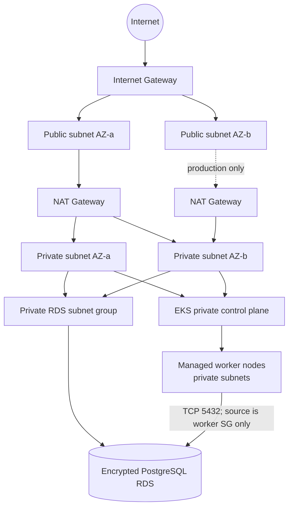

# IdeaBoard AWS infrastructure

This directory contains reusable AWS Terraform infrastructure definitions. No Terraform apply, AWS provisioning, or cloud deployment has been run.

## Architecture



The EKS Kubernetes API endpoint has private access enabled and public access disabled. Public subnets are tagged for future load balancers; this repository does not create an application load balancer or deploy the application into EKS. Worker egress is limited to the VPC CIDR; AWS API access is through private endpoints rather than unrestricted internet egress.

## Directory and module responsibilities

```text
infrastructure/
  .gitignore
  README.md
  modules/
    networking/
      main.tf
      variables.tf
      outputs.tf
    kubernetes/
      main.tf
      variables.tf
      outputs.tf
    database/
      main.tf
      variables.tf
      outputs.tf
  environments/
    development/
      main.tf
      variables.tf
      outputs.tf
      terraform.tfvars.example
    production/
      main.tf
      variables.tf
      outputs.tf
      terraform.tfvars.example
```

### Reusable modules

- **`modules/networking`** creates the VPC, DNS support, internet gateway, paired public/private subnets, Kubernetes discovery tags, route tables and associations, NAT gateways, and private endpoints for EC2, ECR API/Docker, EKS, EKS Auth, STS, and S3. Development puts interface endpoints in one private AZ to reduce hourly charges; production places them in each AZ. Public subnets do not auto-assign public IPs.
- **`modules/kubernetes`** creates the EKS cluster IAM role, KMS key for Kubernetes secret encryption, private-only EKS control plane, managed node role/group, launch template with IMDSv2 required, and explicit worker security group. The launch template attaches both the worker group and EKS cluster group to nodes. AWS-managed worker and ECR policies are scoped to the node role; the VPC CNI policy uses a dedicated EKS Pod Identity role and managed add-ons.
- **`modules/database`** creates a private DB subnet group, RDS security group, and encrypted PostgreSQL RDS instance with backups, storage autoscaling, optional Multi-AZ, deletion protection, and a final snapshot. Ingress on TCP 5432 references the EKS worker security group ID supplied by the Kubernetes module; there is no public database ingress.

Each environment root configures the AWS provider and passes inputs/outputs between these modules. The module code contains no environment-specific subnet CIDRs, AZ names, resource sizes, or AWS provider configuration.

## Environment profiles

| Setting | Development example | Production example |
| --- | --- | --- |
| NAT gateways | One shared NAT for lower cost | One per AZ for AZ-level egress resilience |
| EKS workers | 2 desired, smaller instance type | 3 desired, larger instance type |
| RDS | Single AZ, smaller instance, 3-day backups | Multi-AZ, larger instance, 14-day backups |
| Deletion protection | Off for disposable development | On |
| State backend | Local by default; configure remote state before team use | Remote encrypted state and locking are prerequisites before production operations |

These are sample values, not verified prices or promises of regional availability. Confirm EKS Kubernetes versions, PostgreSQL engine versions, AZ names, instance classes, and CIDR non-overlap in the target region before planning.

## Password and Terraform state handling

Example variable files intentionally contain no database password. The root and database-module password inputs are marked `sensitive` and `ephemeral`, and RDS uses the provider's write-only `password_wo` argument. Supply a password only through `TF_VAR_db_password`, not a command-line argument or tfvars file. `password_wo_version` must be incremented when rotating the password so the provider knows to update it.

The default backend is local because a state bucket/account was not provisioned. The `infrastructure/.gitignore` excludes `.terraform/`, state, local tfvars, and crash files; lockfiles remain versionable. Do not commit state or local credentials. Before team/production use, configure an encrypted, access-controlled remote S3 backend with locking and recovery/versioning controls. The Terraform plan/state still contains infrastructure metadata and must be protected.

## Network, IAM, and lifecycle notes

- Public subnets have a route through the internet gateway; private subnets route outbound IPv4 through NAT. Worker nodes and RDS have no public IPs.
- EKS worker nodes can access VPC services and private AWS endpoints, but not arbitrary internet destinations. ECR layer downloads use the S3 gateway endpoint. Mirror external application images (including GHCR images) to ECR before deployment, or introduce a separately reviewed egress proxy/firewall design.
- Private EKS API access means `kubectl` administration requires a VPN, Direct Connect, or a suitably placed management host. A normal internet-connected laptop cannot directly reach that endpoint.
- RDS ingress references the worker-node security group, not the EKS control-plane security group or a VPC-wide CIDR. The EKS launch template explicitly attaches the worker group so the RDS rule targets actual nodes.
- The EKS cluster uses `AmazonEKSClusterPolicy`; worker nodes use `AmazonEKSWorkerNodePolicy` and `AmazonEC2ContainerRegistryReadOnly`; the dedicated CNI role gets `AmazonEKS_CNI_Policy` through Pod Identity. Review AWS-managed policy updates and narrow further if workload requirements permit.
- RDS storage encryption uses the AWS-managed KMS key unless account policy overrides it. EKS secrets use a customer-managed, automatically rotating KMS key. Automated backups are retained for the configured interval; deletion requires a final snapshot. The final snapshot name is stable per environment, so remove/rename an existing final snapshot before repeating a teardown with the same identifier.
- Development uses a single NAT gateway and single-AZ interface endpoints as cost/availability trade-offs. Production per-AZ NAT gateways and interface endpoints avoid cross-AZ dependencies but cost more. The worker security group intentionally does not allow general internet egress, so NAT is not a blanket bypass for node traffic.

## Commands

Use PowerShell from the repository root. Start by copying an example only when the local file does not already exist:

```powershell
Copy-Item infrastructure\environments\development\terraform.tfvars.example `
  infrastructure\environments\development\terraform.tfvars
```

Edit the local tfvars for an AWS-supported region, Kubernetes and PostgreSQL versions, and non-overlapping subnet CIDRs. The `*.tfvars` files are ignored by Git.

Set the password without echoing it, then format, initialize without a remote backend, and validate:

```powershell
$secret = Read-Host "RDS master password" -AsSecureString
$env:TF_VAR_db_password = [System.Net.NetworkCredential]::new("", $secret).Password

terraform fmt -check -recursive infrastructure
terraform -chdir=infrastructure/environments/development init -backend=false
terraform -chdir=infrastructure/environments/development validate
terraform -chdir=infrastructure/environments/development plan -var-file=terraform.tfvars

Remove-Item Env:TF_VAR_db_password
```

For production, use `infrastructure\environments\production`, first configure the remote backend, and review the plan with the AWS account owner. Do not run `terraform apply` or `destroy` without explicit approval and a reviewed cost/state plan.

CI initializes both roots with `-backend=false`, runs `terraform fmt -check -recursive`, `terraform validate`, and Trivy configuration scanning. Validation does not authenticate to AWS, confirm live regional service availability, or prove that a later AWS plan/apply will succeed.

## Scope and limitations

- AWS only. GCP provider files were empty scaffolding and are not represented as a supported implementation.
- No AWS resources are provisioned by this repository's current workflow; CI performs static validation/scanning only.
- No Kubernetes app manifests/Helm chart, application deployment, public ingress/TLS, remote Terraform state, or automatic database secret delivery is included.
- EKS/RDS/NAT, interface endpoints, KMS, and data transfer can be expensive. Development is lower cost but still has non-zero hourly charges if deployed.
